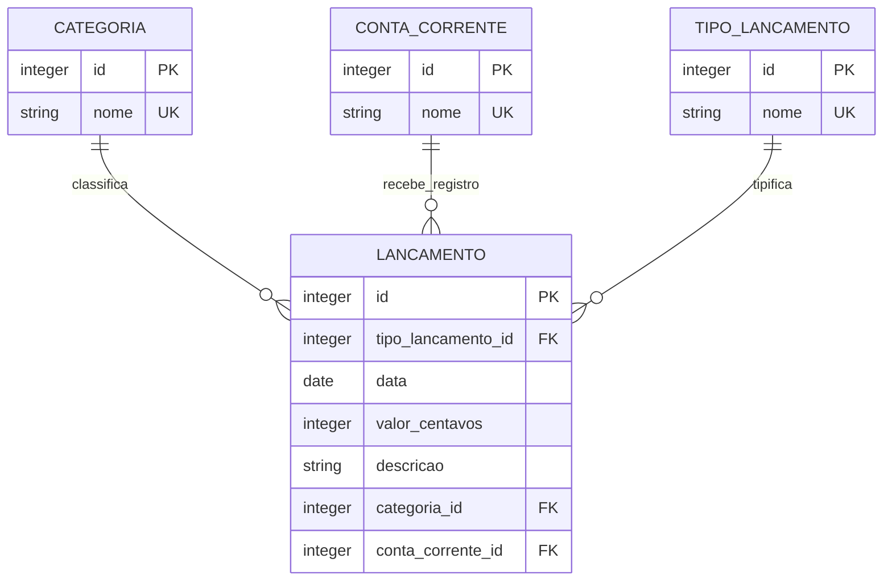

# Modelo de dados e evolução

Base: [PRD](../product/PRD.md), REQ-001 a REQ-008, REQ-010 e REQ-012. Estado: modelo observado em [schema.py](../../app/scripts/schema.py) e [transaction_migration.py](../../app/scripts/transaction_migration.py); não é inspeção do conteúdo do banco local.

## Entidades após inicialização bem-sucedida

`date` representa a data de negócio; não há horário ou fuso nesse campo. A aplicação grava a representação `YYYY-MM-DD`.

| Entidade/campo | Persistência | Validação da API |
|---|---|---|
| IDs de todas as entidades | `INTEGER PRIMARY KEY AUTOINCREMENT` | IDs positivos; limites completos em transaction; limite superior ausente nos filtros dos cadastros |
| `nome` dos três cadastros | `VARCHAR(100) NOT NULL`, unicidade `COLLATE NOCASE` em tabelas novas e índices únicos para bases legadas | Texto aparado de 3 a 100 caracteres |
| Relações de `lancamento` | Três inteiros NOT NULL com referências aos cadastros | Inteiro real, não booleano, de 1 a 9223372036854775807; existência verificada na transação |
| `data` | `DATE NOT NULL` | Data de calendário válida, inclusive futura |
| `valor_centavos` | `INTEGER NOT NULL CHECK(typeof(valor_centavos) = 'integer' AND valor_centavos > 0)` | Mesmo limite positivo dos IDs; rejeitar frações, strings e booleanos |
| `descricao` | `TEXT NOT NULL` | Texto aparado de 3 a 255 caracteres |

As tabelas não são STRICT. Comprimentos, calendário e normalização são garantias da aplicação, não de `VARCHAR`/`DATE`. `NOCASE` não define equivalência geral de acentos/Unicode. Ver [tipos e collations do SQLite](https://www.sqlite.org/datatype3.html), consultado em 28/10/2026; a versão SQLite do ambiente de implantação ainda precisa ser registrada.

Há índices `ix_lancamento_data`, `ix_lancamento_tipo_lancamento_id`, `ix_lancamento_categoria_id` e `ix_lancamento_conta_corrente_id`. Não há índice composto declarado para toda combinação de filtro/ordenação nem garantia de desempenho derivada apenas desses índices.

Não existem entidades de usuário, perfil, organização, moeda, saldo, transferência ou auditoria. Não há `created_at`, `updated_at`, autor, versão de registro ou marcação de exclusão. `DELETE` remove fisicamente o lançamento. Relações não declaram exclusão em cascata. O MVP é de igreja única; não adicionar `tenant_id` ou propriedade multi-igreja. Identidade e histórico dependem de F-004/T-002.

## Fronteiras transacionais

| Operação | Unidade atual |
|---|---|
| Criar cadastro | Uma inserção, commit, rollback em falhas tratadas e fechamento da conexão |
| Consultar cadastro | Uma consulta por conexão; sem unidade de trabalho compartilhada entre chamadas |
| Criar/editar/excluir lançamento | `BEGIN IMMEDIATE`, leitura/validação relacional e escrita na mesma conexão; commit ou rollback antes de fechar |
| Listar lançamentos | `BEGIN`, contagem e seleção de página na mesma transação |
| Preparar/migrar schema | `BEGIN IMMEDIATE` envolvendo consolidação, conversão e índices; rollback global em exceção |

`get_connection()` habilita `PRAGMA foreign_keys = ON` em cada conexão criada por essa função. Acesso externo ao arquivo não passa por essa garantia. Não há pool, conexão global, WAL configurado, política própria de repetição ou timeout configurável no projeto.

O SQLite permite um escritor simultâneo; `BEGIN IMMEDIATE` pode falhar por disputa. O código converte erros SQLite em erro operacional, sem retry específico. As transações de leitura mantêm uma visão consistente durante a própria transação; páginas obtidas em requisições distintas podem mudar com novas gravações. Fonte: [transações SQLite](https://www.sqlite.org/lang_transaction.html), consultada em 28/10/2026.

Atomicidade não resolve edições baseadas em leitura antiga do cliente. PATCH mescla com o registro atual dentro da transação, mas mudanças no mesmo campo e PUT podem substituir o trabalho anterior. Não há ETag, versão esperada ou resposta de conflito definida. Q-005 deve decidir se será necessário controle otimista e qual política de conflito. POST não tem chave de idempotência; repetir uma solicitação pode duplicar o lançamento.

## Migração atual

1. Criar cadastros ausentes e tabela legada `lancamento` com `valor` se ainda não existir.
2. Para cada cadastro, consolidar nomes equivalentes no menor ID e redirecionar os lançamentos; remover cadastros redundantes e criar índice único.
3. Se `valor_centavos` não existir, ler lançamentos e converter `Decimal(str(valor)) * 100` com `ROUND_HALF_UP`; rejeitar valores inválidos, não finitos, não positivos ou fora do limite após arredondamento.
4. Criar tabela de destino, copiar os registros com valores convertidos, remover a antiga, renomear a nova e restaurar a sequência de IDs.
5. Criar índices e confirmar a transação inteira.

IDs dos lançamentos são mantidos; IDs de cadastros consolidados são substituídos nas referências. A tabela temporária de conversão é `lancamento_centavos`. O algoritmo mantém os registros convertidos em memória, aspecto a medir para volume grande (Q-005).

A detecção da conversão usa presença da coluna; não há tabela de versão de migrações nem downgrade implementado. A execução repetida evita reconverter centavos, mas ainda executa a preparação/consolidação. A migração não valida datas e descrições legadas com todas as regras da API; não prometer saneamento completo de dados históricos.

## Compatibilidade e recuperação

Versões que usam `valor` não são compatíveis com o schema convertido. Antes de atualização real, o README exige backup e parada dos processos. Proposta operacional: ensaiar em cópia isolada, conferir contagens, referências, valores e sequência; identificar a versão do código correspondente ao backup; somente liberar atendimento após validação.

Se a migração falhar antes do commit, o código executa rollback e deve preservar o estado anterior (AC-017). Após commit, não há reversão automática: retorno a versão anterior requer restaurar backup compatível com a aplicação parada. Escritas feitas depois do backup podem ser perdidas; janela de recuperação depende de Q-006. Nenhuma cópia, restauração ou migração foi executada nesta etapa.

Evoluções para autoria, exclusão lógica, moeda ou propriedade de recursos exigem decisão de produto, estratégia para registros existentes e nova análise de compatibilidade. Não interpretar valores antigos como pertencentes a usuário/organização sem regra confirmada.

## Revisão de escopo — 04/11/2026

O MVP atende uma única igreja, com os papéis Administrador, Presidente, Tesoureiro e Membro. [ADR-004](decisions/ADR-004-igreja-unica-rbac.md) e [escopo organizacional](isolamento-igrejas.md) definem a revisão. Preservar schema financeiro e unicidade global; não adicionar igreja_id, usuario_igreja ou contexto/seletor de igreja. Contratos de identidade e histórico permanecem propostos, sem implementação. Administração de contas e permissões é exclusiva do Administrador.
