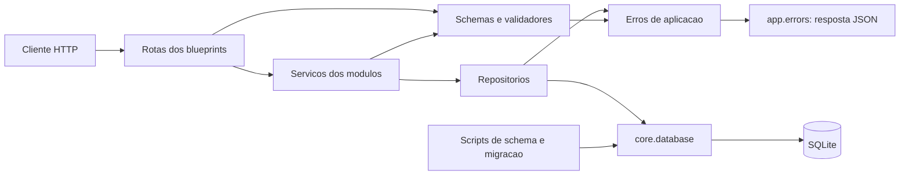

# Arquitetura — My Church ERP

## Estado, escopo e leitura

Versão 0.1, 28/10/2026. Base: [PRD v0.1](../product/PRD.md), branch `feature/api-transaction`, commit `02d08b4` e código local. Esta documentação descreve a arquitetura existente e propostas delimitadas; não declara requisitos aprovados, implementação nova ou prontidão para operação compartilhada.

O uso compartilhado está confirmado, mas perfis, visibilidade, interface e operação continuam pendentes (Q-001 a Q-007 do PRD). O núcleo é pequeno; os documentos foram separados porque contratos, migrações e segurança têm decisões e leitores distintos, sem criar novos serviços ou camadas apenas para documentação.

| Documento | Conteúdo |
|---|---|
| [Modelo de dados](data-model.md) | Entidades, invariantes, transações, migração e recuperação |
| [Contratos](contracts.md) | API atual, interfaces internas, erros e compatibilidade |
| [Segurança](security.md) | Controles existentes, ausência de identidade e proposta de pontos de autorização |
| [ADR-001](decisions/ADR-001-monolito-modular.md) | Preservação do monólito modular e da stack |
| [ADR-002](decisions/ADR-002-centavos-e-transacoes.md) | Valores em centavos e fronteiras transacionais |
| [ADR-003](decisions/ADR-003-acesso-compartilhado.md) | Autenticação e autorização sem assumir perfis |
| [Handoff](handoff.md) | Entradas para planejamento e decisões dependentes do produto |

## Visão atual

Uma aplicação Flask expõe uma API HTTP/JSON e usa um arquivo SQLite. Não há frontend, serviço de identidade, fila, cache, integração bancária ou serviço externo identificado. Os quatro módulos compartilham banco e processo de aplicação, sem fronteiras de implantação independentes.

O diagrama representa dependências principais, não uma imposição de camadas puras: serviços dos cadastros montam fragmentos SQL de filtros; o repositório de lançamentos revalida o objeto completo durante atualização e produz sua representação de resposta.

## Responsabilidades e requisitos

| Componente existente | Responsabilidade | PRD |
|---|---|---|
| `app/__init__.py`, `app/api/__init__.py` | Factory, configuração e registro dos blueprints, incluindo erros globais da aplicação | REQ-009 |
| `app/modules/category` | Criar e consultar categorias | REQ-001, REQ-002 |
| `app/modules/checking_account` | Criar e consultar contas | REQ-001, REQ-002 |
| `app/modules/transaction_type` | Criar e consultar classificações livres de lançamento | REQ-001, REQ-002 |
| `app/modules/transaction` | CRUD, regras do lançamento, filtros, paginação, relações e transações | REQ-003, REQ-004, REQ-005, REQ-006, REQ-007, REQ-008, REQ-012 |
| `app/core/validators.py`, `app/core/errors.py`, `app/errors.py` | Validações comuns, erros próprios e representação HTTP | REQ-001, REQ-009 |
| `app/core/database.py` | Abrir conexão e habilitar chaves estrangeiras | REQ-012 |
| `app/scripts/schema.py`, `transaction_migration.py` | Preparar esquema, consolidar cadastros e converter valores legados | REQ-010, REQ-012 |
| Identidade/autorização | Não existe; proposta em security.md e ADR-003 | REQ-011 |

Cada módulo tem `routes.py`, `schema.py`, `services.py` e `repository.py`. `schema.py` desses módulos valida entradas; não é o DDL do banco. `app/core/config.py`, `app/extensions.py` e `category/exceptions.py` estão vazios e não representam componentes ativos.

## Inicialização e configuração

Após F-003/T-002 (04/11/2026), `python -m app.run` cria a aplicação com `create_app()` e chama `main()`: prepara o schema no contexto dessa aplicação e inicia `app.run(debug=app.config['DEBUG'])` somente se a preparação terminar.

**Importação:** importar `app.run` expõe `app` sem conexão, preparação ou servidor. A factory permanece sem schema.

| Configuração | Leitura atual | Limite |
|---|---|---|
| `DATABASE_PATH` | Variável de ambiente convertida em `app.config.DB_PATH` na importação | Padrão `app/db/igreja_erp.db`; não há provisionamento de diretório customizado |
| `DATABASE` | Chave de `current_app.config` preferida por `get_connection()` | Usada pelos testes; ausente na configuração padrão |
| `DB_PATH` | No contexto usa a chave da aplicação quando `DATABASE` está ausente; fora dele lê o módulo de configuração a cada resolução | Ambiente continua lido apenas na importação de config |
| `FLASK_DEBUG` | Valores 1/true/yes ativam `DEBUG`; padrão desativado | Não é controle de acesso |

Preparação e requisições usam a mesma resolução, conforme [contrato implementado](../features/F-003-dados-e-migracao/contrato-configuracao.md). Destinos explícitos inválidos falham com ValueError, sem fallback; aceitam-se strings não vazias e PathLike. Diretórios não são criados automaticamente.

## Fluxos críticos

1. **Criar cadastro:** rota lê JSON; serviço valida; repositório insere e confirma; erro de unicidade vira erro de integridade. Retorno 201 com ID/nome.
2. **Criar lançamento:** validar corpo → abrir transação de escrita → confirmar existência das relações → inserir → consultar resultado com joins → confirmar → responder 201. Falha implica rollback e fechamento.
3. **Atualizar:** validar ID e payload → abrir transação de escrita → ler registro → mesclar campos → revalidar conjunto e relações → atualizar → consultar resultado → confirmar. Não há versão de recurso enviada pelo cliente.
4. **Listar lançamentos:** validar filtros → abrir transação de leitura → contar e consultar página na mesma conexão/transação → fechar → responder com dados e metadados.
5. **Migrar:** abrir transação de escrita → criar tabelas ausentes → consolidar cadastros legados → converter valores → criar índices → confirmar. Erro reverte a unidade inteira. Detalhes e recuperação em data-model.md.

## Operação, observabilidade e limites

O entrypoint atual usa o servidor de desenvolvimento. Para operação real, a proposta é escolher execução WSGI e hospedagem após Q-006; não há fornecedor ou servidor selecionado. A documentação oficial de [implantação Flask 3.1.x](https://flask.palletsprojects.com/en/stable/deploying/), consultada em 28/10/2026, orienta uso de servidor apropriado fora de desenvolvimento. O manifesto fixa Flask 3.1.3; isso não comprova a versão instalada na futura implantação.

Repositórios registram falhas com `logging`; não há configuração central de observabilidade, correlação de requisições, métricas ou trilha de auditoria. Proposta: registrar operação, resultado, duração e identificador de correlação sem corpos financeiros ou credenciais; definir retenção e acesso aos logs operacionais com Q-006. O histórico de auditoria persistido tem retenção eterna conforme ADR-005. Não definir metas de disponibilidade ou latência sem Q-005/Q-006.

Para WSGI, preparar o schema em etapa controlada antes dos processos de atendimento, com a mesma configuração. Importar o entrypoint não migra. O comando local preserva a preparação via main(); nenhuma nova CLI foi criada. O README documenta a chamada explícita.

## Verificação e próximos limites

| Escopo | Evidência e verificação posterior |
|---|---|
| REQ-001/002, AC-001 a AC-004 | Testes dos três cadastros; acrescentar caso do limite superior de ID, hoje com OverflowError confirmado na análise anterior |
| REQ-003 a REQ-009/012, AC-005 a AC-015 | `app/tests/test_lancamento.py`: CRUD, rejeições, filtros, paginação e falha de banco; completar lacunas por critério |
| REQ-010/012, AC-016/017 | `test_schema.py` e `test_transaction_migration.py`: consolidação, conversão, sequência e rollback; usar apenas bases sintéticas |
| REQ-011, AC-018/019 | Ausente; depende de regras de identidade, operação e escopo, incluindo testes negativos por recurso |
| Concorrência/operação | Não há medição de capacidade, teste de conflitos nem restauração validada; planejar após decisões do PRD |

Comando documentado: `python -m pytest` após instalar `requirements-dev.txt` em ambiente apropriado. Esta etapa apenas inspecionou documentos e código; não executou suíte, servidor ou migração. A limitação anterior de pytest ausente continua registrada, sem nova tentativa de instalar dependências.

Riscos restantes: validação de ID nos cadastros, configuração divergente, respostas de erro não universais, ausência de acesso controlado, concorrência sem detecção de versão antiga e exclusão definitiva sem histórico. Nenhum deles foi corrigido por esta documentação.

## Revisão de escopo — 04/11/2026

O MVP atende uma única igreja, com os papéis Administrador, Presidente, Tesoureiro e Membro. [ADR-004](decisions/ADR-004-igreja-unica-rbac.md) e [escopo organizacional](isolamento-igrejas.md) definem a revisão. Preservar schema financeiro e unicidade global; não adicionar igreja_id, usuario_igreja ou contexto/seletor de igreja. Contratos de identidade e histórico permanecem propostos, sem implementação. Administração de contas e permissões é exclusiva do Administrador.
